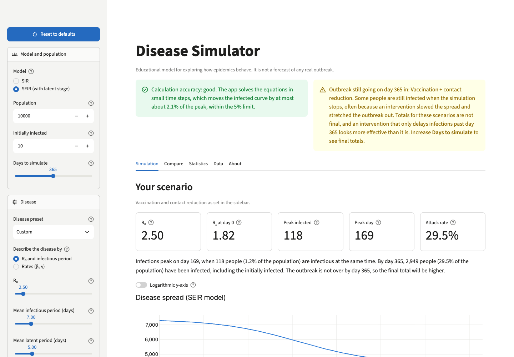
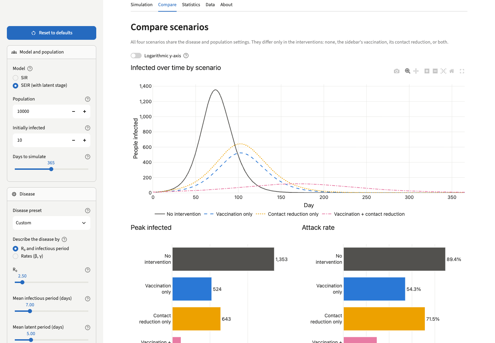
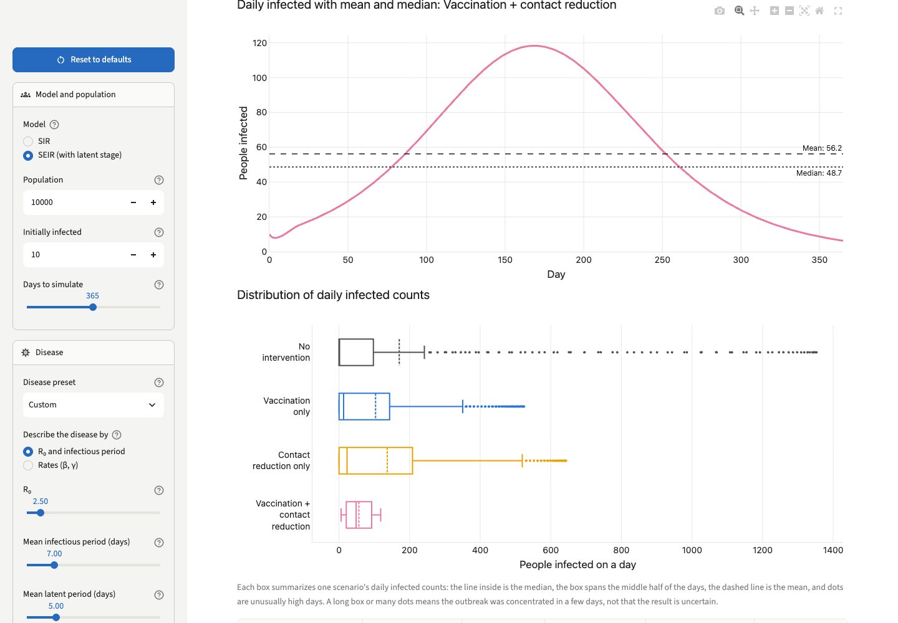

# Disease Simulator

[](https://github.com/Jaydenzga/Disease-Simulator/actions/workflows/tests.yml)


An interactive epidemic simulator built with Python and Streamlit. Pick an SIR or SEIR model or a disease preset, add vaccination and distancing, and compare four intervention scenarios side by side, with plain-language explanations of every number.

**Live demo:** _coming soon (deployment on Streamlit Community Cloud is pending)_

> **Educational use only.** This is a simplified model for learning how epidemics behave. It is not fitted to any real outbreak and must not be used to forecast cases or make health decisions.



## Features

- **Two models:** SIR, and SEIR with a latent (infected but not yet infectious) stage, sharing one tested simulation engine.
- **Disease presets:** COVID-19 (original strain and Delta), seasonal and 1918 influenza, measles, and chickenpox, with sources for every value. They are labeled as educational approximations.
- **Interventions:** vaccination (all-or-nothing or leaky) and time-limited contact reduction.
- **Scenario comparison:** no intervention, vaccination only, contact reduction only, and both, with infections averted.
- **Descriptive statistics:** mean, median, and SD of the infected curve, with a clear explanation of what they do *not* measure.
- **Honest numbers:** the app estimates its own numerical error and warns when an outbreak has not finished by the last day.
- **Interactive, accessible charts:** Plotly hover and zoom, colorblind-safe colors with a distinct line pattern per series, and a layout that works on phones.
- **CSV downloads** of daily results and scenario summaries.

| Compare scenarios | Statistics |
|---|---|
|  |  |

## Run it locally

Requires Python 3.11 or newer.

```bash
git clone https://github.com/Jaydenzga/Disease-Simulator.git
cd Disease-Simulator
python3 -m venv .venv
source .venv/bin/activate        # Windows: .venv\Scripts\activate
pip install -r requirements.txt
streamlit run main.py
```

The app opens at http://localhost:8501 with an illustrative SEIR outbreak (R₀ = 2.5, N = 10,000) and both interventions switched on. **Reset to defaults** in the sidebar restores these settings at any time.

## Using the app

Every control has a **?** tooltip in plain language.

| Group | Control | Meaning |
|---|---|---|
| Model and population | Model | **SIR**, or **SEIR**, which adds an Exposed stage (infected but not yet infectious) |
| | Population, Initially infected | Total number of people (N), and how many are infectious on day 0 |
| | Days to simulate | Length of the simulation (up to 730 days) |
| Disease | Disease preset | Rounded published values for well-known diseases. Moving a disease slider switches back to **Custom**. |
| | Describe the disease by | **R₀ and mean infectious period**, or the **rates** β and γ. Switching converts the current values. |
| | Mean latent period (days) | SEIR only: average time from infection to becoming infectious |
| Vaccination | Coverage, effectiveness, vaccine model | **Immunity**: that % of vaccinated people are fully immune. **Partial protection**: every vaccinated person's risk is reduced by that %. |
| Contact reduction | Reduction, start day, optional end day | Distancing or masking: lowers transmission by this % while active |
| Numerical accuracy | Simulation steps per day | 4 by default; more steps are more accurate. 1 reproduces the original app. |

The dashboard has a status area and five tabs:

- **Status area:** whether the calculation is accurate enough, and whether every scenario's outbreak is over by the last day. An outbreak can still be running at the end when interventions slow the spread and stretch it out; increase **Days to simulate** to see final totals.
- **Simulation:** summary cards (R₀, Rₑ at day 0, peak infected, peak day, attack rate), a one-paragraph summary, and the compartment chart (optional log scale).
- **Compare:** the four scenarios' infected curves, bar charts, and a comparison table with infections averted.
- **Statistics:** descriptive statistics of the infected curve, with an explanation of deterministic results, numerical error, and statistical uncertainty.
- **Data:** daily results with CSV downloads.
- **About:** the full model description from [docs/MODEL.md](docs/MODEL.md).

## The models

```
SIR:   S ──β·S·I/N──▶ I ──γ·I──▶ R
SEIR:  S ──β·S·I/N──▶ E ──σ·E──▶ I ──γ·I──▶ R
```

- **S** susceptible, **E** exposed (latent), **I** infectious, **R** recovered, **V** vaccinated. S + E + I + R + V = N on every day.
- R₀ = β / γ, the same for SIR and SEIR. γ = 1 / mean infectious period, σ = 1 / mean latent period.
- Vaccination happens once on day 0; contact reduction multiplies β by (1 − reduction) while active.
- The equations are solved with forward Euler using several steps per day. The app checks its own accuracy by re-running with twice as many steps.

**[docs/MODEL.md](docs/MODEL.md)** has the full equations, parameter table, preset sources, numerical method, metric formulas, assumptions, and references.

## Architecture

```
main.py                 Streamlit entry point (calls disease_sim.interface.run)
disease_sim/
  parameters.py         Frozen input dataclasses with validation (rejects NaN, ∞, out-of-range values)
  interventions.py      Vaccination and contact reduction
  models.py             Shared SIR/SEIR engine: inputs → DataFrame (day, S, E, I, R, V)
  metrics.py            Summary metrics and descriptive statistics
  scenarios.py          Four-scenario comparison in long format
  presets.py            Disease presets
  visualization.py      Plotly figure builders
  explain.py            Tooltips, captions, and plain-language summaries
  export.py             CSV export
  interface.py          Streamlit dashboard (the only module that imports streamlit)
tests/                  Pytest suite, including Streamlit AppTest UI tests
docs/MODEL.md           Scientific documentation
docs/DEPLOYMENT.md      Deployment guide
docs/ROADMAP.md         Development plan and approved decisions
```

Design choices:

- **Pure simulation core.** Only `interface.py` imports Streamlit, so the model, metrics, and charts are tested without a browser.
- **One data format.** Every model run returns the same DataFrame, which metrics, charts, and CSV export all use.
- **Validation in one place.** Input dataclasses reject invalid values with clear errors, shared by the UI and the tests.
- **Caching.** Results are cached on the (immutable) inputs, so moving back to earlier settings is instant.

## Testing and CI

```bash
pip install -r requirements-dev.txt
pytest                                  # about 1,600 tests
ruff check . && ruff format --check .   # lint and formatting
```

The tests check that the population total is conserved and no compartment goes negative, even at extreme rates; that SIR at 1 step per day reproduces the original version of this app exactly; that SIR and SEIR match the Kermack–McKendrick final-size equation; that interventions and metrics match hand calculations; that charts have the expected series and axes; that preset values are the documented ones; and that the dashboard's tabs, presets, reset button, CSV downloads, caching, and input limits work.

**Continuous integration** ([`.github/workflows/tests.yml`](.github/workflows/tests.yml)) runs on every pull request and every push to `main`:

1. **Lint:** `ruff check` and `ruff format --check`.
2. **Tests:** the full suite on Python 3.11, 3.12, 3.13, and 3.14, with the locked dependencies, then a check that the app starts and responds.
3. **Minimum versions:** the full suite with the oldest supported dependencies (`ci/requirements-min.txt`) on Python 3.11.

Any failing step fails the workflow, and the badge at the top shows the status of `main`.

**Dependencies.** `requirements.in` lists the direct dependencies and their supported ranges. `requirements.txt` is a lock file generated from it with exact versions, so local installs, CI, and the deployed app use the same packages. To update:

```bash
uv pip compile --universal --python-version 3.11 requirements.in -o requirements.txt
```

## Deployment

The app is designed for the free tier of [Streamlit Community Cloud](https://streamlit.io/cloud): entry file `main.py`, dependencies from `requirements.txt`, no secrets or environment variables. Step-by-step instructions and free alternatives are in **[docs/DEPLOYMENT.md](docs/DEPLOYMENT.md)**.

## Scientific limitations

- **Everyone mixes equally.** No households, ages, places, or contact networks.
- **No deaths, births, or migration,** and immunity after recovery or vaccination is permanent.
- **Deterministic and continuous.** No chance events and fractional people, so small outbreaks never die out by chance.
- **Fixed parameters.** No seasonality and no behavior change in response to the outbreak.
- **Exponential waiting times.** Latent and infectious periods have the right averages but too much spread.
- **Presets are approximations.** They use rounded published values, which vary by variant, population, immunity, and setting, and are not fitted to any outbreak. Because waiting times are exponential, most presets make outbreaks grow more slowly than real ones, although the final size matches their R₀ ([MODEL.md §2](docs/MODEL.md#how-fast-outbreaks-grow-the-generation-time)).

## Intended educational use

The simulator is meant for students and curious readers who want to see *why* epidemics behave as they do: why R₀ matters, why vaccination coverage has a threshold, why lifting distancing early causes a rebound, and why a model's numbers carry numerical error separate from real-world uncertainty. It is a teaching and portfolio project. It is not a public-health tool and makes no predictions about real diseases.

## Future improvements

- **Stochastic simulation** (Phase 5): random outbreaks, distributions of outcomes, and hypothesis tests on simulated data.
- **More realistic disease features:** deaths (SEIRD), waning immunity (SEIRS), and vaccination rolled out over time.
- **Structured populations:** age groups, or contact networks (graph-based transmission).
- **Real-user testing** of the deployed app, with fixes for the most confusing parts.
